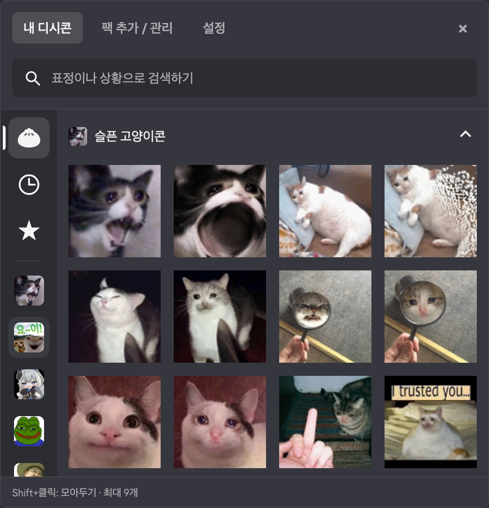
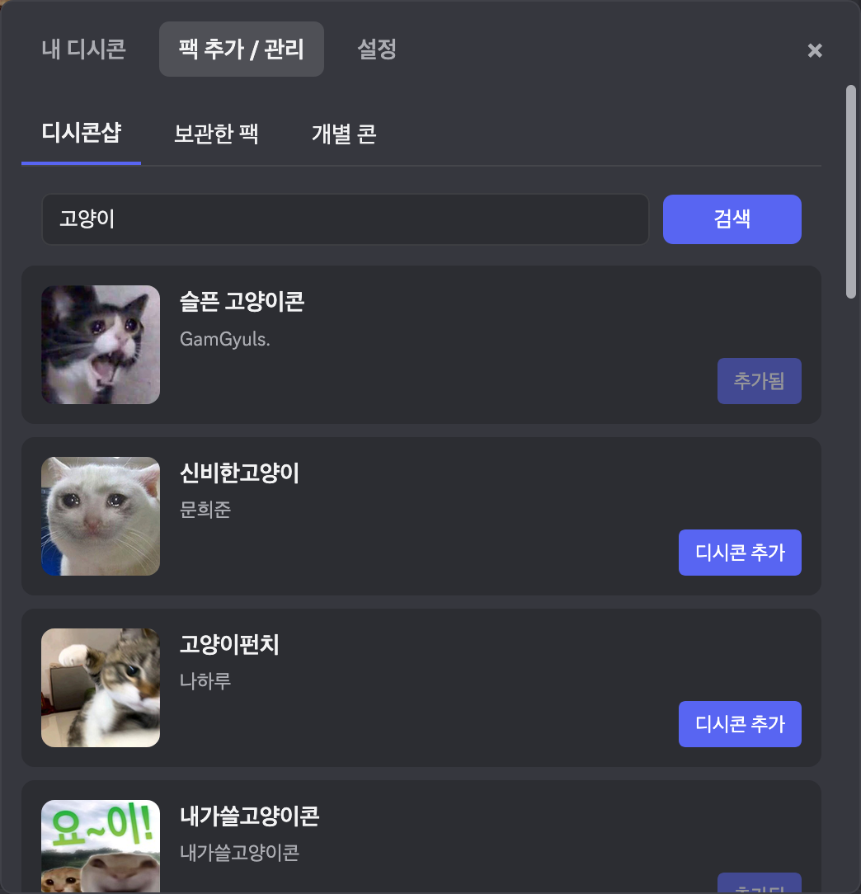
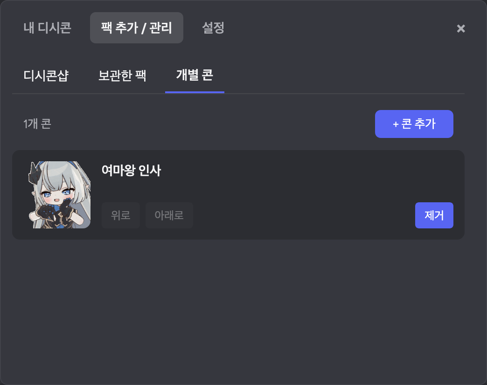
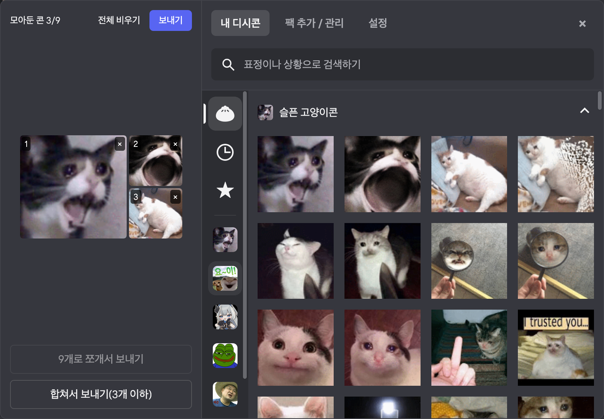
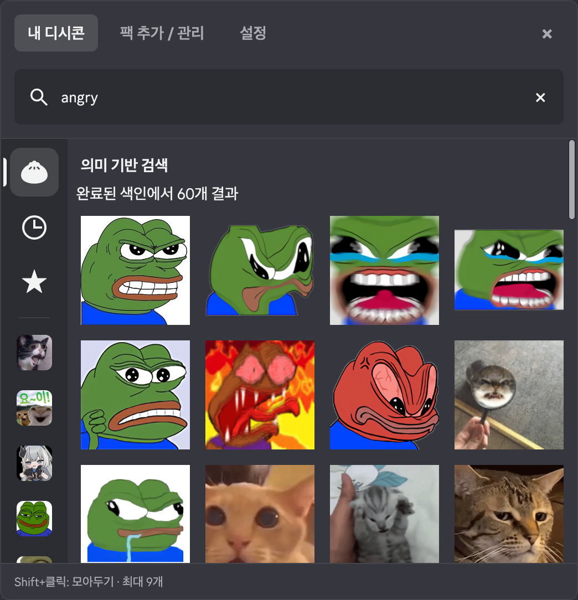
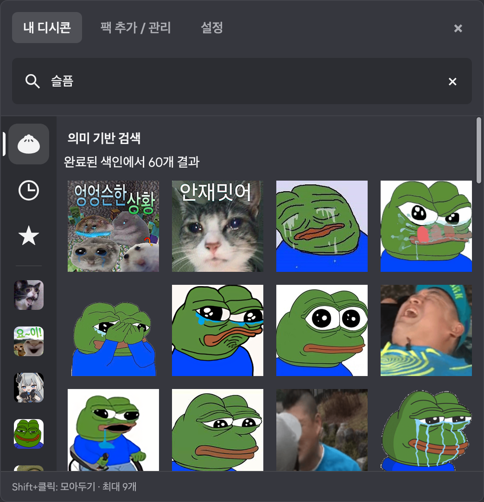
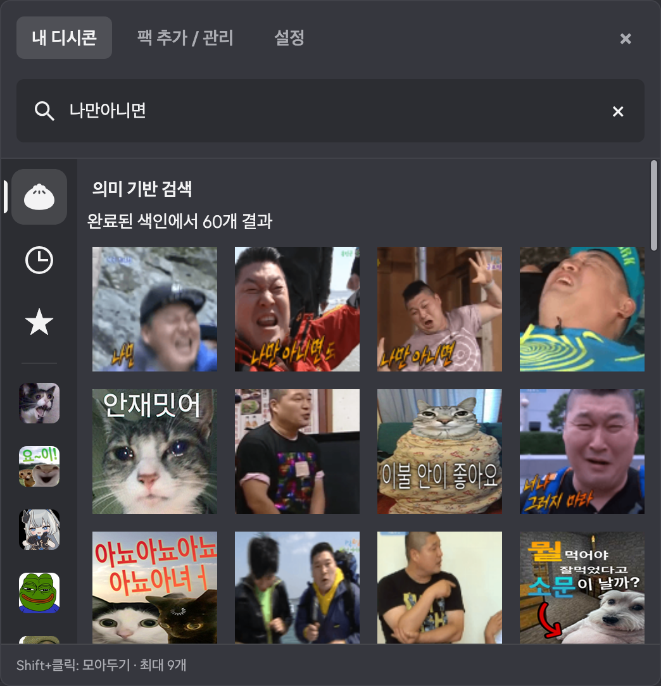

# discord-dccon

Discord 채팅 입력창에서 디시콘을 보내는 확장입니다. BetterDiscord 플러그인 또는 일반 Discord에 직접 설치해 사용합니다.




## 주요 기능

- 클릭하면 디시콘을 이미지로 전송
- 채팅 입력창의 만두 버튼으로 디시콘 메뉴 열기
- 디시콘 팩 검색·추가·제거, 등록한 콘 검색
- 디시콘·아카콘 링크로 개별 콘 추가·제거
- 좌측 팩 탐색, 최근 사용, 즐겨찾기
- Shift+클릭으로 여러 콘을 모아서 함께 전송
- 의미 기반 검색

## 설치

Discord 종료하고 아래 명령을 실행합니다. **BetterDiscord 혹은 Shelter가 있으면 플러그인으로, 없으면(바닐라, Vencord) standalone으로 자동 설치**합니다. 업데이트도 같은 명령으로 하면 됩니다.

**Windows — PowerShell**

```powershell
powershell -c "irm https://github.com/80ROkWOC4j/discord-dccon/releases/latest/download/install.ps1 | iex"
```

**macOS — 터미널**

```sh
curl -fsSL https://github.com/80ROkWOC4j/discord-dccon/releases/latest/download/install.sh | bash
```

Discord 업데이트 하면서 일부 파일이 바뀌면 작동하지 않을 수 있습니다. 그럴 때는 재설치 해야 합니다.

### BetterDiscord 수동 설치

[Release](https://github.com/80ROkWOC4j/discord-dccon/releases)에서 **`discord-dccon.plugin.js`**를 다운로드합니다. Discord의 **설정 → BetterDiscord → 플러그인 → 플러그인 폴더 열기**로 연 폴더에 파일을 넣고 플러그인을 활성화합니다.

### 웹 Discord에서 사용하기

**Firefox(데스크톱, 안드로이드) + Violentmonkey**에서 테스트 되었습니다.

1. Firefox에 [Violentmonkey](https://violentmonkey.github.io/get-it/) 확장 기능을 설치합니다.
2. **[디시콘 유저스크립트 설치](https://github.com/80ROkWOC4j/discord-dccon/releases/download/v4.0.0-beta.2/discord-dccon.user.js)**를 클릭하고, 열린 Violentmonkey 화면에서 **설치**를 누릅니다.

안드로이드에서는 [Wappify](https://addons.mozilla.org/en-US/firefox/addon/wappify/)랑 쓰면 좀 더 편합니다.

<details>
<summary>PTB·Canary, 제거 및 기타 옵션</summary>

기본 채널은 `stable`입니다. PTB와 Canary는 채널 옵션으로 선택합니다.

Windows에서 옵션을 사용하려면 스크립트 다운받아야 합니다.

```powershell
powershell -c "irm https://github.com/80ROkWOC4j/discord-dccon/releases/latest/download/install.ps1 -outfile install.ps1"
powershell -noprofile -executionpolicy bypass -file .\install.ps1 -channel ptb
# 제거 (Stable 기준)
powershell -noprofile -executionpolicy bypass -file .\install.ps1 -remove
```

macOS에서는 `bash -s --` 뒤에 옵션을 지정합니다.

```sh
curl -fsSL https://github.com/80ROkWOC4j/discord-dccon/releases/latest/download/install.sh | bash -s -- --channel ptb
# 제거 (Stable 기준)
curl -fsSL https://github.com/80ROkWOC4j/discord-dccon/releases/latest/download/install.sh | bash -s -- --remove
```

Windows는 `-option`, macOS는 `--option` 형식을 사용합니다.

```text
SYNOPSIS
    powershell -noprofile -executionpolicy bypass -file .\install.ps1 [options]
    bash install.sh [options]

OPTIONS
    -channel, --channel stable|ptb|canary
        대상 Discord 채널. 기본값: stable.

    -mode, --mode auto|betterdiscord|standalone
        설치 방식. 기본값: auto. 감지 결과와 다른 방식을 지정하면 중단.

    -version, --version <tag>
        설치할 릴리스 태그. 생략하면 최신 릴리스. 예: v3.5.1.

    -remove, --remove
        디시콘 제거. 설정·캐시와 BetterDiscord 자체는 유지.

    -discordroot <path>
        Windows 전용. Discord 설치 경로를 직접 지정.

    -pluginsdirectory <path>
        Windows 전용. BetterDiscord 플러그인 폴더를 직접 지정.
```

</details>

## 사용법

### 선택창 열기와 팩 추가

채팅 입력창 오른쪽의 **만두 버튼**을 클릭하면 디시콘 선택창이 열립니다.


**팩 추가 / 관리 → 디시콘샵**에서 이름을 검색하고 **디시콘 추가**를 누릅니다. 추가한 팩은 **내 디시콘** 탭에서 선택할 수 있습니다.



### 개별 콘 추가

**팩 추가 / 관리 → 개별 콘 → 콘 추가**에서 디시콘·아카콘 이미지 링크를 등록할 수 있습니다.



### 기본 사용법

| 조작 | 동작 |
| --- | --- |
| 일반 클릭 | 모아둔 콘과 클릭한 콘을 전송하고 선택창 닫기 |
| Shift+클릭 | 디시콘 누적 하면서 선택창 유지 |
| ☆ / ★ | 즐겨찾기 추가 / 해제 |

### 콘 모으기

Shift+클릭한 콘은 **모아둔 콘** 패널에 예상 메시지 배치로 표시됩니다. **전송**을 누르면 미리보기의 콘만 한 메시지로 보내고, 콘을 일반 클릭하면 그 콘을 하나 더 추가해 전송합니다. 미리보기의 콘을 누르면 개별 삭제할 수 있습니다. 미리보기는 pc 환경 기준으로 맞춰졌습니다.



콘을 **1개만 모으면** 미리보기 아래의 **9개로 쪼개서 보내기** 버튼이 활성화됩니다. 이미지를 3×3으로 나눠 한 메시지로 보냅니다.

콘을 **2~3개 모으면**, 같은 길이면 **합쳐서 전송** 버튼이 활성화됩니다. 이러면 이미지 하나로 보냅니다.

### 공통 설정·데이터 경로

<details>
<summary>로컬에 저장되는 것들 상세 설명</summary>

| OS | 공통 데이터 경로 |
| --- | --- |
| Windows | `%APPDATA%\discord-dccon\` |
| macOS | `~/Library/Application Support/discord-dccon/` |
| Linux | `~/.config/discord-dccon/` |

```text
config.json               공통 설정과 완료된 데이터 형식 버전
discord-dccon-library/     직접 추가한 이미지
cache/
  images/                 개별 콘 WebP
  merged/                 합친 콘 WebP
  webp-codecs/            인코더
  models/                 임베딩 모델·런타임
  vectors/<모델·전처리 버전>/
    <이미지 키의 SHA-256>.json
```

팩을 추가하면 이미지를 다운로드해 `cache/images`에 보관합니다. 벡터는 `(path, ext)` 이미지 키별 파일에 저장하며, 검색은 공통 등록 목록을 대상으로 합니다. 콘을 제거해도 공유 캐시의 벡터는 삭제하지 않습니다.

캐시 용량 제한과 자동 정리는 없습니다.

</details>

## 의미 기반 검색

설정에서 의미 기반 검색을 키면 임베딩모델을 다운받고 디시콘들 임베딩 합니다. 기존의 검색은 벡터 검색으로 바뀝니다.





## 진단

문제가 있으면 **설정 → 문제 해결 · 버그 제보**에서 마지막 전송 결과를 확인할 수 있습니다.

이슈 제보 시 이것을 사용해 에러 메세지를 확인해서 같이 올려주세요.

## 출처 및 라이선스

- 원본 프로젝트: [DCCon2](https://github.com/minibox24/DCCon) 현재 삭제 상태
- 참고 프로젝트: [Dastan21/BDAddons — FavoriteMedia](https://github.com/Dastan21/BDAddons/blob/main/plugins/FavoriteMedia/FavoriteMedia.plugin.js)
- 스탠드얼론 기반: [shelter](https://github.com/uwu/shelter) — 공식 배포본을 [`vendor/shelter`](vendor/shelter) submodule의 커밋으로 고정
- 라이선스: [GNU GPL v3](LICENSE)
